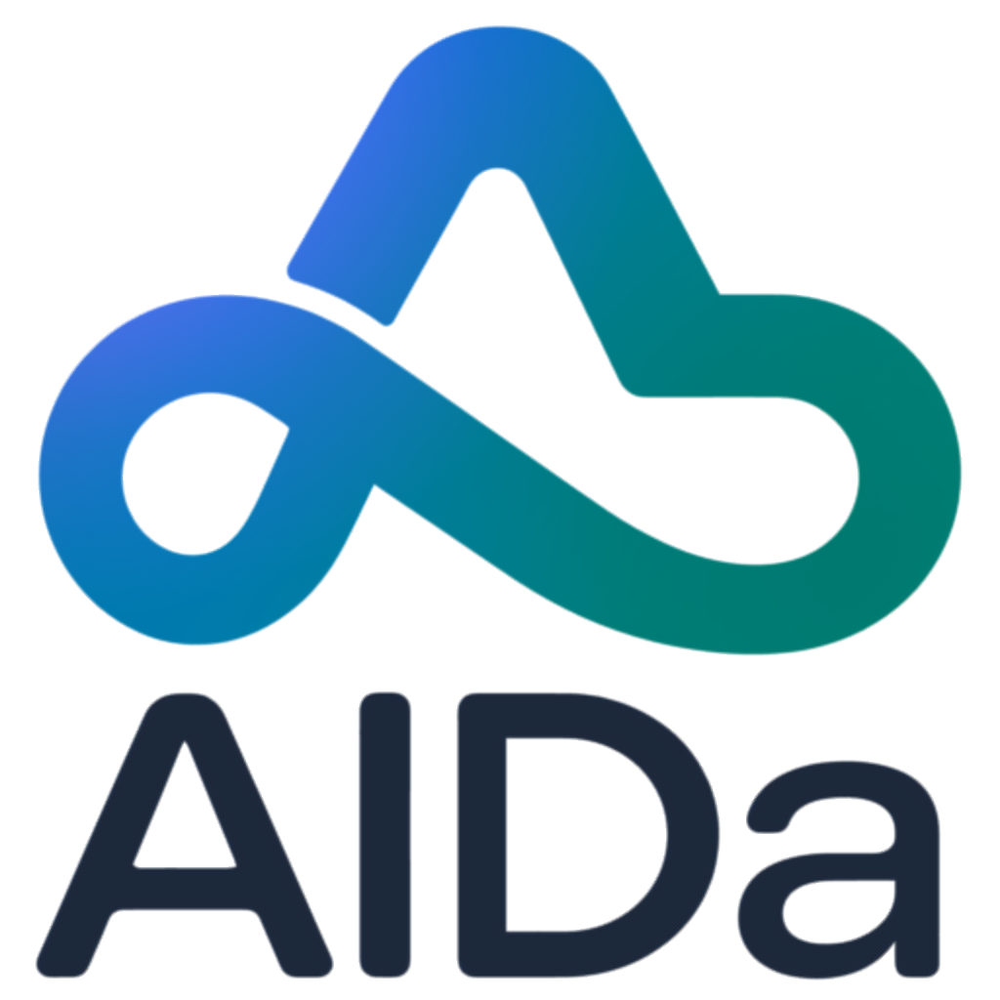

```markdown
# Alda — Multi-Wallet Cash Flow Manager

> **Aplikasi pencatatan keuangan offline-first** untuk pribadi & usaha mikro.  
> Cepat, ringan, dan bisa di-install sebagai PWA di HP/tablet/desktop.

[](https://alda-xxx.vercel.app)
[](https://vuejs.org)
[](https://web.dev/progressive-web-apps/)
[](./LICENSE)



---

## ✨ Fitur Utama

### 💰 Multi-Wallet Management
- Kelola banyak dompet dalam satu dashboard (Kas Warung, Rekening, E-Wallet, Tabungan)
- Total saldo gabungan dari semua dompet real
- Transfer antar dompet tanpa mengubah total kekayaan
- Detail per dompet: saldo, ringkasan bulan ini, utang/piutang, transaksi terbaru

### 📊 Transaksi Fleksibel
- **Income** — pemasukan dengan kategori & catatan
- **Expense** — pengeluaran single-wallet atau multi-wallet
- **Split Payment otomatis** — saat saldo dompet utama kurang, sistem menyarankan dompet talangan
- **Toggle Pinjam** — talangan bisa ditandai pinjaman (auto-create utang internal)
- **Transfer** — pindah dana antar dompet
- **Piutang** — catat pengeluaran sebagai piutang ke pihak luar

### 🤝 Utang & Piutang (Model Wallet Temporer)
- **Pihak luar** (Andi, Budi, Koperasi) direpresentasikan sebagai **wallet temporer**
- Otomatis dibuat saat pertama kali catat pinjaman/piutang ke nama tersebut
- Muncul di section "Pihak Luar" di halaman `/wallets`
- **Auto-hilang** saat debt lunas
- **Pelunasan** cicilan atau lunas dengan tracking sisa

### 🏷️ Kategori Custom
- 8 kategori default: Gaji, Bonus, Lainnya (income) + Makanan, Transportasi, Belanja, Tagihan, Lainnya (expense)
- CRUD kategori dengan icon picker
- Kategori selector pakai modal picker (konsisten dengan UI tanggal)

### 🔍 Filter, Export & Laporan
- **Filter lanjutan** di `/transactions`: tanggal, jenis, dompet, kategori, search
- **Quick range**: Hari ini, 7 hari, 30 hari, Bulan ini, Bulan lalu
- **Export CSV** sesuai filter aktif (untuk Excel/accounting)
- **Laporan bulanan** di `/reports`:
  - Ringkasan: pemasukan/pengeluaran/net + delta % vs bulan lalu
  - Per kategori: bar chart income & expense
  - Per dompet: bar chart in & out
  - Pure CSS bar chart — zero dependency

### 🗑️ Reset Data
- **Reset Transaksi** — hapus semua transaksi & pinjaman, wallet & kategori tetap ada (saldo kembali ke awal)
- **Reset Semua** — mulai fresh seperti user baru (seed ulang 8 kategori)
- Konfirmasi typed text untuk safety ("HAPUS" / "RESET SEMUA")

### 📱 Offline-First & PWA
- Semua operasi tersimpan lokal dulu (IndexedDB via Dexie.js)
- Sync ke Supabase cloud di background
- Multi-device: input di HP → muncul di tablet dalam hitungan detik
- **Installable** sebagai PWA di Android/iOS/Desktop
- Bisa dibuka offline (data lokal + service worker cache)

---

## 🛠️ Tech Stack

| Layer | Teknologi |
|---|---|
| **Frontend** | Vue 3 (Composition API) + Vite |
| **Styling** | Tailwind CSS v4 + Lucide Icons |
| **State** | Pinia |
| **Local DB** | Dexie.js (IndexedDB) |
| **Cloud DB** | Supabase (PostgreSQL + Auth + RLS) |
| **PWA** | vite-plugin-pwa (Workbox) |
| **Hosting** | Vercel (auto-deploy dari GitHub) |

---

## 🚀 Cara Install (Development)

### Prerequisites
- **Node.js** 18+ ([download](https://nodejs.org))
- **npm** 9+ (bundled with Node)
- **Akun Supabase** ([daftar gratis](https://supabase.com))
- **Akun Vercel** (opsional, untuk deploy)

### Langkah-langkah

**1. Clone repo**
```bash
git clone https://github.com/Ocipsss/alda.git
cd alda
```

2. Install dependencies

```bash
npm install
```

3. Setup Supabase

· Buat project baru di Supabase Dashboard
· Copy Project URL dan anon key dari Settings → API
· Buka SQL Editor, jalankan SQL schema lengkap (lihat dokumentasi setup di commit history atau CONCEPT.md)
· Di Authentication → Providers → Email, matikan "Confirm email" (untuk development)

4. Setup environment variables

Buat file .env.local di root project:

```env
VITE_SUPABASE_URL=https://xxxxx.supabase.co
VITE_SUPABASE_ANON_KEY=eyJhbGciOiJIUzI1NiIsInR5cCI6IkpXVCJ9...
```

5. Jalankan dev server

```bash
npm run dev
```

Buka http://localhost:5173 di browser.

6. Install PWA (opsional)

Kalau mau test PWA secara lokal:

```bash
npm run build
npm run preview
```

Buka http://localhost:4173, klik tombol Install di Chrome address bar.

---

📦 Build & Deploy

Build production

```bash
npm run build
# Output: dist/
```

Preview build

```bash
npm run preview
```

Deploy ke Vercel

Otomatis via GitHub:

1. Push ke branch main
2. Vercel auto-detect → build → deploy
3. Set environment variables di Vercel Dashboard:
   · VITE_SUPABASE_URL
   · VITE_SUPABASE_ANON_KEY

Manual via Vercel CLI:

```bash
npm i -g vercel
vercel --prod
```

---

📱 Install as PWA

Android (Chrome):

1. Buka URL aplikasi di Chrome
2. Tap menu (⋮) → Install app / Add to Home Screen
3. Icon Alda muncul di home screen

iOS (Safari):

1. Buka URL di Safari
2. Tap tombol Share → Add to Home Screen
3. Icon Alda muncul di home screen

Desktop (Chrome/Edge):

1. Buka URL aplikasi
2. Klik icon Install di address bar
3. Alda terinstal sebagai aplikasi desktop

---

📚 Dokumentasi

Dokumen Isi
CONCEPT.md Visi produk, definisi fitur, roadmap, glosarium
ARCHITECTURE.md Detail teknis, layer arsitektur, alur sync, skema DB
RULES.md Aturan kerja sama & konvensi teknis

---

🎯 Roadmap

Fase Fitur Status
1 Setup (Vue, Vite, Tailwind, PWA, Dexie, Supabase) ✅ Selesai
2 Auth + CRUD Dompet + Icon/Color Picker ✅ Selesai
3 Transaksi (Income, Expense, Transfer) ✅ Selesai
3.5 CRUD Kategori UI ✅ Selesai
4 Utang & Piutang + Pelunasan ✅ Selesai
Refactor Separation of Concerns (constants, lib, repos, services) ✅ Selesai
5 Split Bill (auto-talangan di ExpenseModal) ✅ Selesai
6 Filter, Export CSV, Laporan Bulanan ✅ Selesai
6.5 Wallet Temporer + Reset Data + Bottom Nav ✅ Selesai
7 Onboarding & Tutorial interaktif ⬜ Rencana

Lihat detail roadmap di CONCEPT.md Bagian 5.

---

🏗️ Struktur Project (Ringkas)

```text
src/
├── components/     # UI components (modal-driven, one-handed friendly)
├── composables/    # useAutoSync (global sync lifecycle)
├── constants/      # Domain constants (types, labels, config)
├── db/             # Dexie schema + seed
├── lib/            # Pure utilities (balance, format, filter, csv, report)
├── repositories/   # Data access layer (Dexie CRUD)
├── services/       # Business logic (atomic operations)
├── stores/         # Pinia stores (state global)
├── router/         # Vue Router + auth guard
└── views/          # Page-level components
```

Detail lengkap di ARCHITECTURE.md Bagian 2.

---

🔐 Privacy & Security

· Row Level Security (RLS) di Supabase — user hanya bisa akses data sendiri (auth.uid() = user_id)
· Session persisten — pakai JWT token, disimpan di local storage browser
· Environment variables — .env.local tidak pernah di-commit ke Git
· Soft delete — data yang dihapus masih tersimpan di cloud (bisa recover via Supabase admin)
· Auto-recovery — kalau session corrupt (misal setelah clear site data), app force signOut & redirect ke login

---

🧪 Testing

Manual test checklist lengkap ada di ARCHITECTURE.md Bagian 13.

Coverage:

· Auth (register, login, session persist, logout, session recovery)
· Wallet (CRUD, temporary wallet, cleanup)
· Transaction (income, expense, split payment, transfer)
· Debt (internal, external via temporary wallet, pelunasan)
· Filter, Export CSV, Laporan
· Reset Data
· Sync & Offline
· PWA install

---

🤝 Kontribusi

Project ini personal project untuk penggunaan pribadi & usaha mikro. Kalau mau kontribusi:

1. Fork repo
2. Buat branch fitur (git checkout -b feat/fitur-baru)
3. Commit perubahan (git commit -m "feat: tambah fitur X")
4. Push ke branch (git push origin feat/fitur-baru)
5. Buka Pull Request

Kontak developer:

· GitHub: @Ocipsss

---

📄 Lisensi

MIT License — bebas dipakai, dimodifikasi, dan didistribusikan.

```
Copyright (c) 2026 Alda

Permission is hereby granted, free of charge, to any person obtaining a copy
of this software and associated documentation files (the "Software"), to deal
in the Software without restriction...
```

(Lihat file LICENSE untuk teks lengkap — atau buat sendiri kalau belum ada.)

---

🙏 Credits

· Vue 3 — vuejs.org
· Vite — vitejs.dev
· Tailwind CSS v4 — tailwindcss.com
· Lucide Icons — lucide.dev
· Dexie.js — dexie.org
· Supabase — supabase.com
· vite-plugin-pwa — vite-pwa-org.netlify.app
· Vercel — vercel.com

---

© Alda 2026
Dibangun dengan ❤️ untuk pencatatan keuangan yang simpel & cepat.